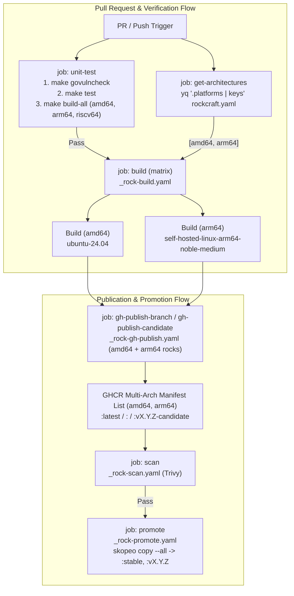

# Design: Multi-Architecture Binary and Container Rock Support

## Context

See [proposal.md](./proposal.md) for problem statement and motivation.

The repository compiles the `secure-token-service` Go binary and packs it into an Ubuntu 24.04 (`noble`) Chisel rock (`base: bare`). Today, `rockcraft.yaml` lists only `amd64` in `platforms`, and `.github/workflows/ci.yaml` calls `canonical/identity-team/.github/workflows/_rock-build.yaml` once with the default `amd64` input. In addition, `build.sh`, `Dockerfile`, and `skaffold.yaml` hardcode `amd64` assumptions.

The upstream reusable workflow `canonical/identity-team/.github/workflows/_rock-build.yaml` supports `amd64` on `ubuntu-24.04` runners and `arm64` on `self-hosted-linux-arm64-noble-medium` runners. Similarly, `_rock-gh-publish.yaml` assembles multi-architecture OCI manifest lists when the caller omits the single-artifact `rock` input.

## Goals / Non-Goals

**Goals:**
- Compile and verify the Go binary for all three target architectures (`amd64`, `arm64`, and `riscv64`) during unit testing.
- Build and test container images and rocks only for the two supported image architectures (`amd64` and `arm64`).
- Publish unified `amd64` and `arm64` multi-architecture OCI manifest lists to GHCR for branch and release builds.

**Non-Goals:**
- Building, testing, or publishing container images or rocks for `riscv64`.
- Modifying runtime application configuration, database schemas, or API contracts.

## Architecture & Pipeline Flow

## Decisions

### Decision 1: Build Go Binaries for 3 Architectures (`amd64`, `arm64`, `riscv64`) and Container Images for 2 (`amd64`, `arm64`)
- **Choice**:
  1. Add a `build-all` target in `Makefile` and run it in `.github/workflows/unittest.yaml` to compile `./cmd/sts` with `CGO_ENABLED=0` for `GOOS=linux` across `GOARCH=amd64`, `GOARCH=arm64`, and `GOARCH=riscv64` (`bin/app-linux-amd64`, `bin/app-linux-arm64`, `bin/app-linux-riscv64`).
  2. Configure container image builds (`rockcraft.yaml`, `skaffold.yaml`, `ci.yaml`) strictly for `amd64` and `arm64`.
- **Rationale**: Go cross-compilation is fast (< 5 seconds) and verifies that all dependencies and system calls remain compatible with `amd64`, `arm64`, and `riscv64`. Container rock builds require native runners and external scanning/test binaries (`container-structure-test`, `syft`, `trivy`) that support `amd64` and `arm64`.
- **Alternatives Considered**:
  - *Build rocks for `riscv64`*: Fails in CI because `_rock-build.yaml` lacks `riscv64` runners and `container-structure-test` does not publish `linux-riscv64` binaries.
  - *Skip `riscv64` binary builds*: Misses compile-time regressions for RISC-V targets.

### Decision 2: Dynamic Architecture Matrix from `rockcraft.yaml`
- **Choice**: Add a `get-architectures` job in `.github/workflows/ci.yaml` that runs `yq -o=json -I=0 '.platforms | keys' rockcraft.yaml` and feeds `strategy.matrix.architecture` on the `build` job.
- **Rationale**: This pattern matches `authorization-service`, `identity-platform-login-ui`, `hydra-rock`, and `kratos-rock`. It keeps `rockcraft.yaml` (`amd64` and `arm64`) as the single source of truth for container image architectures.
- **Alternatives Considered**:
  - *Hardcode `matrix: { architecture: [amd64, arm64] }` in `ci.yaml`*: Duplicates platform declarations across two files.

### Decision 3: Multi-Architecture Manifest Assembly in `_rock-gh-publish.yaml`
- **Choice**: Remove `with: rock: ${{ needs.build.outputs.rock }}` from `gh-publish-branch` and `gh-publish-candidate` in `.github/workflows/ci.yaml`.
- **Rationale**: When `rock` is empty, `_rock-gh-publish.yaml` downloads both `amd64` and `arm64` `*.rock` artifacts from the matrix jobs, pushes per-architecture tags (`<version>-amd64`, `<version>-arm64`), and creates a multi-architecture manifest list.
- **Alternatives Considered**:
  - *Pass `needs.build.outputs.rock`*: In a matrix job, `needs.build.outputs.rock` keeps only one matrix entry and publishes a single-architecture image.

### Decision 4: Parameterize Local and Container Build Files (`Makefile`, `Dockerfile`, `build.sh`, `skaffold.yaml`)
- **Choice**:
  - In `rockcraft.yaml`, add `arm64: null` to `platforms` and set `export GOOS=linux`, `export GOARCH="${CRAFT_ARCH_BUILD_FOR}"`, and `export CGO_ENABLED=0` before `make build`.
  - In `Makefile`, default `GOOS` and `GOARCH` to the host environment (`$(shell $(GO) env GOOS)` and `$(shell $(GO) env GOARCH)`), pass `CGO_ENABLED=$(CGO_ENABLED) GOOS=$(GOOS) GOARCH=$(GOARCH)` to `$(GO) build`, and add `build-all` (`amd64`, `arm64`, `riscv64`).
  - In `Dockerfile`, accept `ARG TARGETOS=linux` and `ARG TARGETARCH=amd64` and pass `GOOS=${TARGETOS} GOARCH=${TARGETARCH}` to `go build`.
  - In `build.sh`, default `IMAGE="${IMAGE:-secure-token-service:dev}"`, detect `ARCH` via `dpkg --print-architecture` with fallback to `go env GOARCH`, validate that `ARCH` is `amd64` or `arm64`, and set `ROCK_FILE="secure-token-service_${VERSION}_${ARCH}.rock"`.
  - In `skaffold.yaml`, set `platforms: ["linux/amd64", "linux/arm64"]`.
- **Rationale**: Aligns all container tooling on `amd64` and `arm64` while `Makefile` supports host-native builds and compiling Linux binaries for `amd64`, `arm64`, and `riscv64`.
- **Alternatives Considered**:
  - *Modify only `rockcraft.yaml` and `ci.yaml`*: Leaves `build.sh`, `Dockerfile`, and `skaffold.yaml` hardcoded to `amd64`.

## Upstream Interface Requirements (`canonical/identity-team`)

1. **`_rock-promote.yaml` Multi-Architecture Copy ([`canonical/identity-team#156`](https://github.com/canonical/identity-team/pull/156), `v1.17.1`)**:
   - `_rock-promote.yaml` runs `rockcraft.skopeo --insecure-policy copy --all "$source_image" "docker://ghcr.io/${{ github.repository }}:${tag}"` as of `v1.17.1` (`6e3d618fb7650a26b7a2254a15fef1d28373bd9d`).
   - `.github/workflows/ci.yaml` pins `canonical/identity-team` reusable workflows to `v1.17.1` so multi-architecture manifest lists are preserved intact during candidate promotion.

## Database Schema Modifications

None. This change modifies only build scripts, container packaging manifests, and CI workflows.

## Security, Performance, Observability, Scalability, and Migration Considerations

- **Security**: Static compilation (`CGO_ENABLED=0`) eliminates C library attack surface across all binaries. Both `amd64` and `arm64` rocks include the `deb-security-manifest` part and pass through the existing Trivy security gate before promotion.
- **Performance**: Native `arm64` rocks run on ARM64 Kubernetes nodes without QEMU emulation overhead. Parallel matrix builds keep total CI wall-clock time equal to a single-architecture build.
- **Observability**: Each matrix build job generates and uploads a per-architecture SPDX SBOM artifact (`secure-token-service_<version>_<arch>.rock.sbom.json`).
- **Scalability**: Dynamic platform discovery in `ci.yaml` scales automatically from `rockcraft.yaml`.
- **Migration Plan**:
  1. Merge the `rockcraft.yaml`, workflow, and build script changes to `main`.
  2. Update branch protection rules in `canonical-repo-automation` so required status checks match `build (amd64) / Build (amd64)` and `build (arm64) / Build (arm64)`.
  3. Roll back by removing `arm64` from `rockcraft.yaml` if self-hosted ARM64 runner capacity fails.

## Risks / Trade-offs

- **[Risk] Self-hosted ARM64 runner queue delays** $\rightarrow$ *Mitigation*: `build` runs only after `unit-test` passes, which prevents broken pull requests from consuming ARM64 runner capacity.
- **[Risk] GitHub branch protection check name mismatch** $\rightarrow$ *Mitigation*: Matrix jobs change the check name to include the matrix value; coordinate branch protection ruleset updates in `canonical-repo-automation`.
- **[Risk] `skopeo copy` in `_rock-promote.yaml` drops non-amd64 manifests** $\rightarrow$ *Mitigation*: Track and merge [`canonical/identity-team#156`](https://github.com/canonical/identity-team/pull/156) in `canonical/identity-team/.github/workflows/_rock-promote.yaml` before cutting a multi-architecture release tag, and verify promoted tags with `docker manifest inspect`.
