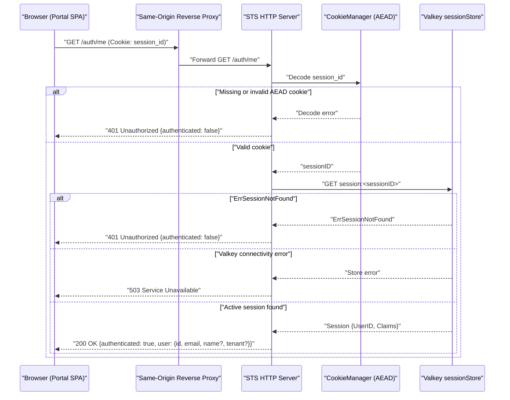

# Design

## Context

See [proposal.md](proposal.md) for product motivation and [specs/session-whoami/spec.md](specs/session-whoami/spec.md) and [specs/claims-normalization/spec.md](specs/claims-normalization/spec.md) for behavioral requirements.

Today, [internal/http/server.go](../../../internal/http/server.go) decodes the AEAD `session_id` cookie via `CookieManager` and reads sessions from Valkey (`ValkeyStore`) in `handleHome` and `handleLogout`. However:

- `handleCallback` (OIDC) decodes only `email` from the verified ID token, leaves `Session.Claims` as `nil`, and stores `oauth2Token.Expiry()` in `Session.ExpiresAt` while setting cookie and Valkey TTL from `SESSION_EXPIRY`.
- `handleOpenIDCallback` (Ubuntu One OpenID 2.0) populates `Session.Claims` and sets `Session.ExpiresAt = now.Add(s.sessionLifetime())`, but does not preserve optional `given_name` or tenancy attributes when returned.
- `cmd/sts/extend_sessions.go` updates `Session.ExpiresAt = newToken.Expiry` rather than aligning with the extended Valkey TTL.
- `Server.Router()` and `Server.StartWithMiddleware()` duplicate HTTP route registration.

No PostgreSQL schema changes apply because PostgreSQL stores only `hydra_jwk` signing keys ([001_create_jwks_table.sql](../../../internal/db/migrations/001_create_jwks_table.sql)).

## Goals / Non-Goals

**Goals:**

- Serve `GET /auth/me` directly from `CookieManager` and `session.Store` with zero PostgreSQL queries and zero upstream IdP network calls.
- Populate normalized identity and optional tenancy claims on `Session.Claims` during OIDC logins and preserve optional attributes on OpenID 2.0 logins.
- Align `Session.ExpiresAt` with the configured `SESSION_EXPIRY` across OIDC callbacks, OpenID callbacks, and `extend-sessions`.
- Share a single route-registration helper between `Server.Router()` and `Server.StartWithMiddleware()`.

**Non-Goals:**

- Multi-session listing or revocation endpoints (see `add-session-crud`).
- Cross-origin CORS middleware or stateless user-info cookies.
- Modifying the gRPC `ExchangeSession` protobuf schema.

## Architecture



## Decisions

### 1. Direct Cookie Authentication (No JWT Hairpin)

`GET /auth/me` validates the `session_id` cookie directly in STS instead of requiring an API Gateway to exchange the cookie for an internal JWT first.

- **Rationale**: STS already owns both `CookieManager` and Valkey. Direct validation avoids a `Gateway -> STS (gRPC) -> Gateway -> STS (HTTP)` hairpin loop, preserves immediate revocation truth against Valkey, and keeps JWTs strictly server-to-server per [ADR-004](../../../docs/adr/004-phantom-token-pattern.md).
- **Alternatives Considered**:
  - *Gateway-injected internal JWT*: Adds latency, introduces stale-JWT revocation lag up to `JWT_EXPIRY`, and forces browser auth routes through token exchange.
  - *Stateless user info in cookie*: Eliminates Valkey reads but breaks immediate revocation and bloats every request's `Cookie` header.

### 2. Extract Claims Once at Login into `Session.Claims`

OIDC claim extraction runs once during `handleCallback` by decoding the verified ID token into a `map[string]interface{}` and writing normalized string fields (`sub`, `email`, `name`, `given_name`, `preferred_username`, `idp_provider`, and optional `tenant`) into `Session.Claims`.

- **Rationale**: Keeps `GET /auth/me` to a single O(1) Valkey read with zero JWT re-parsing or upstream `/userinfo` calls. Storing normalized claims in `Session.Claims` also propagates `name` and `tenant` consistently into `ExchangeSession` internal JWTs.
- **Configurable Tenancy Claim**: Add `OIDCTenantClaim` (`envconfig:"OIDC_TENANT_CLAIM" default:"tenant"`) in [internal/config/config.go](../../../internal/config/config.go) and pass it via `WithTenantClaim(claim string)` on `httpserver.Server`. Non-string or empty values are ignored rather than failing login.
- **Alternatives Considered**:
  - *Parse `Session.IDToken` on every `/auth/me` call*: Wastes CPU on every poll and couples whoami to raw OIDC token format.
  - *Call upstream `/userinfo` on `/auth/me`*: Adds network latency, upstream rate-limit risk, and availability coupling.

### 3. Explicit Response Allowlist for `GET /auth/me`

Build the `GET /auth/me` response from a dedicated struct:

```go
type meResponse struct {
    Authenticated bool    `json:"authenticated"`
    User          *meUser `json:"user,omitempty"`
}

type meUser struct {
    ID     string `json:"id"`
    Email  string `json:"email,omitempty"`
    Name   string `json:"name,omitempty"`
    Tenant string `json:"tenant,omitempty"`
}
```

- **Rationale**: Struct allowlisting guarantees upstream `AccessToken`, `IDToken`, `RefreshToken`, `SessionID`, and extra claims cannot leak accidentally. `ID` uses `sess.UserID` (matching `ExchangeSession`'s `sub`). `Email` resolves from `sess.Claims["email"]` or `sess.UserID` when it contains `@` (supporting legacy sessions with `Claims == nil`).
- **Alternatives Considered**:
  - *Serialize `sess.Claims` directly*: Leaks extra IdP attributes and breaks the minimal-surface contract.

### 4. Unified `Session.ExpiresAt` Derived from `SESSION_EXPIRY`

Set `Session.ExpiresAt = now.Add(s.sessionLifetime())` in both `handleCallback` and `handleOpenIDCallback`, and set `sess.ExpiresAt = time.Now().Add(ttl)` in `extendOneSession` ([cmd/sts/extend_sessions.go](../../../cmd/sts/extend_sessions.go)).

- **Rationale**: Keeps `Session.ExpiresAt`, Valkey TTL, and `session_id` cookie expiry synchronized across providers and makes `handleHome` and future session listing accurate.
- **Alternatives Considered**:
  - *Keep `oauth2Token.Expiry()` in `Session.ExpiresAt`*: Causes active 24h OIDC sessions to display as expired after 15–60 minutes.

### 5. Non-Cacheable Responses (`Cache-Control: no-store`) and Error Distinction

Return `Cache-Control: no-store`, `Vary: Cookie`, and `X-Content-Type-Options: nosniff` on all `GET /auth/me` responses. Distinguish `errors.Is(err, session.ErrSessionNotFound)` (`401`) from unexpected Valkey errors (`503`).

- **Rationale**: Prevents shared proxies or browsers from caching stale identity after revocation, and prevents transient Valkey errors from triggering false logouts in Portal.
- **Alternatives Considered**:
  - *Short `Cache-Control: private, max-age=10`*: Reduces repeated SPA calls but introduces a 10-second stale window after remote session revocation.

## Security, Performance, Observability, and Scalability

- **Security**: AEAD authentication in `CookieManager.Decode` rejects missing, corrupted, or forged cookies in memory before touching Valkey. `GET /auth/me` performs no state mutation and sends no `Set-Cookie` headers.
- **Performance & Scalability**: Authenticated requests execute one AEAD decrypt and one O(1) Valkey `GET`. Zero PostgreSQL or upstream IdP calls occur on the read path. Ingress/gateway rate limiting protects against authenticated client polling loops.
- **Observability**: Standard HTTP logging, metrics, and tracing middleware record `GET /auth/me` requests under static route `/auth/me`. Logs never emit raw cookie values or upstream tokens.

## Risks / Trade-offs

- **[Authenticated SPA polling loop spams Valkey]** -> Mitigate via deployment ingress/gateway rate limiting on `/auth/me` and Valkey O(1) lookup efficiency; monitor `http.server.request.count` for `/auth/me`.
- **[In-flight OIDC sessions created before rollout have `Claims == nil`]** -> Mitigate by falling back to `sess.UserID` for `id` and `email` (when containing `@`) and omitting `name`/`tenant` until next login.
- **[Upstream IdP emits non-string tenant claim (e.g., array)]** -> Mitigate by extracting only non-empty string values and logging a debug message when ignored.
- **[Existing `Server.Router()` vs `StartWithMiddleware()` drift]** -> Mitigate by consolidating route mounting into a single helper used by both methods.

## Migration Plan

1. Deploy the updated STS binary with default `OIDC_TENANT_CLAIM=tenant` (no database migration required).
2. Existing Valkey sessions remain valid immediately; new OIDC and OpenID logins store normalized claims and unified `expires_at`.
3. Configure `OIDC_TENANT_CLAIM` in environments whose IdP uses a non-default claim name.
4. Roll back by redeploying the previous image; added keys in `Session.Claims` are backward compatible with older STS versions.
