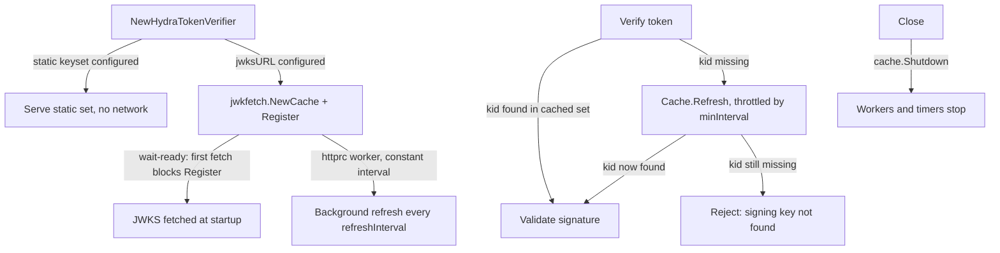

# Design

## Context

The service uses `github.com/lestrrat-go/jwx/v2` in two places (see proposal.md - Why):

1. `internal/auth/hydra.go` (`HydraTokenVerifier`): a preemptively refreshed JWKS cache built on the v2 `jwk.Cache`, used to verify upstream Ory Hydra tokens.
2. `internal/auth/token.go` (`KeyManager`): `jwk.FromRaw`, `key.Set`, `jwk.NewSet`, and `jwk.Parse` to build and serialize the service's own JWKS document.

In v4 the upstream project split HTTP-based JWKS retrieval out of the core module into `github.com/jwx-go/jwkfetch/v4`, removed `jwk.Cache`/`jwk.Fetch`, and made key import/export generic (`jwk.Import[T]`, `jwk.Export[T]`). Constraints: no behavior change may leak into the product contract, and no other dependency major bumps (handled by the parallel dependency-refresh PR).

## Goals / Non-Goals

**Goals:**
- Complete cutover to `github.com/lestrrat-go/jwx/v4` v4.6.0 with the v2 module fully removed.
- Preserve the observable verifier contract: startup warm-up fetch, background refresh, min-interval throttling, static keyset option for tests, and kid-miss refresh-and-retry.
- Keep the `HydraTokenVerifier` public API (`NewHydraTokenVerifier`, options, `Verify`, `Close`) and the `KeyManager` API unchanged.

**Non-Goals:**
- No redesign of refresh cadence values (defaults stay 10 min refresh / 1 min min-interval).
- No URL allowlisting changes; the JWKS URL remains trusted config, not attacker-controlled input.
- No changes to other capabilities' behavior.

## Decisions

### Decision 1: Use `jwkfetch/v4` `Cache` instead of a hand-rolled cache

`jwkfetch.NewCache(ctx, httprc.NewClient(), jwkfetch.WithHTTPClient(c))` plus `Register(ctx, url, jwkfetch.WithConstantInterval(d), jwkfetch.WithMinInterval(d))` reproduces the v2 `jwk.Cache` semantics: background workers refresh registered URLs, `Register` waits for the first fetch by default (`WithWaitReady(true)`), and `Refresh(ctx, url)` forces a throttled re-fetch.

Alternatives considered:
- **In-house cache with a refresh ticker.** Rejected: it re-implements concurrency control, backoff, and throttling that upstream already maintains and audits, for zero behavior gain.
- **One-shot `jwkfetch.Client` per verification.** Rejected: it adds request-time latency to token verification and breaks the preemptive-refresh requirement in the `m2m-token-exchange` spec.

Trade-off: we take a new companion-module dependency (`jwkfetch/v4`, pulling `httprc/v3` and `option/v3`) instead of owning ~100 lines of cache code. Accepted because the upstream module is the documented successor of `jwk.Cache` and stays aligned with jwx releases.

### Decision 2: Map v2 option semantics onto v4 options

- `jwk.NewCache(ctx, jwk.WithRefreshWindow(refreshInterval/2))` → dropped. The v2 refresh window governed the background sweep loop; v4 `httprc` schedules each resource directly.
- `jwk.WithRefreshInterval(d)` → `jwkfetch.WithConstantInterval(d)`: fixed background refresh cadence.
- `jwk.WithMinRefreshInterval(d)` → `jwkfetch.WithMinInterval(d)`: throttles forced refreshes (kid-miss path).
- `jwk.WithHTTPClient(c)` → `jwkfetch.WithHTTPClient(c)` on `NewCache` (fetch policy is cache-wide in v4, not per-URL).
- Startup warm-up (`c.Refresh(ctx, url)` in v2) → implicit in `Register`'s default wait-ready behavior; the explicit warm-up call is removed.

### Decision 3: Mechanical API renames in `KeyManager` and `interfaces.go`

- `jwk.FromRaw(v)` → `jwk.Import[jwk.Key](v)`.
- `key.Raw(&v)` → `jwk.Export[any](key)` (v4 removed `Key.Raw`).
- `jwk.Parse`, `jwk.NewSet`, `key.Set`, and the `jwk.Key`/`jwk.Set` interfaces keep their signatures; only the import path changes to `github.com/lestrrat-go/jwx/v4/jwk`.

### JWKS refresh flow after migration

## Security

- JWKS fetch uses the configured `*http.Client` unchanged; deployments keep control of TLS, proxies, and timeouts. Without a caller-supplied client, `jwkfetch` applies its own safe defaults (30 s timeout, 5-redirect cap, HTTPS-downgrade block).
- JWKS response bodies are capped at 10 MB by the library, bounding decompression/parse cost.
- The JWKS URL remains operator-configured and trusted; no new attacker-controlled fetch surface is introduced, so no whitelist is added.
- Min-interval throttling on kid-miss refreshes is preserved, preventing token floods from amplifying upstream fetch load.
- Error messages from the fetch layer may include the JWKS URL; our URL carries no credentials.

## Performance

Background refresh cadence and min-interval throttling are unchanged, so steady-state upstream traffic and verification latency match v2. `jwkfetch` uses `encoding/json/v2` for parsing, which is faster and lower-allocation than v2's reflection path.

## Observability

No new metrics or logs are added in this change. `httprc` supports error/trace sinks; wiring them into the service's telemetry is a possible follow-up, not required for parity.

## Migration Plan

1. Update `go.mod` to `jwx/v4` v4.6.0 + `jwkfetch/v4`, run `go mod tidy`.
2. Port `hydra.go` to `jwkfetch.Cache` (Decisions 1-2).
3. Port `token.go`, `interfaces.go`, and the three test files to the v4 API (Decision 3).
4. Regenerate mocks, then run the verification suite in tasks.md.
5. Rollback: revert the single commit; no data or config migration exists.

## Risks / Trade-offs

- [v4 behavioral drift in parse/refresh edge cases] → Existing verifier and JWKS endpoint tests cover the contract; trivy scan must stay at zero findings.
- [New transitive modules (`httprc/v3`, `option/v3`) pull in defects] → Both are maintained by the jwx-go org and pinned in `go.sum`; scan covers them.
- [Rebase race with the parallel dependency-refresh PR (#82) on `go.mod`/`go.sum`] → Trivial rebase; whichever PR merges second regenerates `go.sum`. Noted in the PR body.
