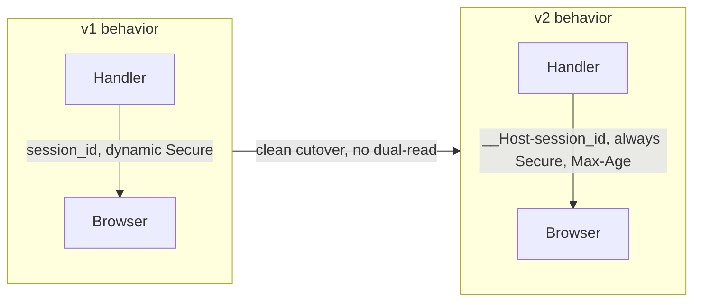

# Design

## Context

`internal/cookie` wraps `github.com/chmike/securecookie` v1.3.5. The v1 API takes a `Params` struct per cookie object, allows `Secure: false`, and checks value age only at decode time. v2.0.1 (`github.com/chmike/securecookie/v2`) replaces `Params` with a mandatory `maxAge` at `New`, forces the `__Host-` name prefix with `Secure`, `HttpOnly`, and `Path=/`, removes `Domain` and `SameSite=None`, and derives encryption keys from a 32-byte seed via `KeyStore`. See proposal.md for motivation.

## Goals / Non-Goals

**Goals:**

- Adopt securecookie v2 behind the existing `CookieManager` API with minimal signature churn.
- Embrace the v2 invariants (`__Host-` prefix, always `Secure`) instead of working around them.
- Keep `Encode(name, value)` and `Decode(name, value, maxAge)` signatures so HTTP and gRPC call sites and their mock interfaces stay unchanged.

**Non-Goals:**

- No dual-read shim for pre-upgrade cookies (see proposal.md).
- No changes to the `CookieManager` interfaces in `internal/http` and `internal/grpc`; mocks do not change.
- No replacement of the cookie library; v2 is the maintained upstream.

## Decisions

### Decision: Clean cutover to `__Host-` prefixed names

All cookies switch to `__Host-` prefixed names (`__Host-session_id`, `__Host-oauth_state`, `__Host-oauth_nonce`). HTTP handlers that read the session cookie (`internal/http/home.go`, `internal/http/server.go`) use the new exported `cookie.SessionCookieName` constant. Cookie values are authenticated with their prefixed name, so old unprefixed values fail decoding even if replayed.

Alternatives considered: reading both names with fallback during a transition window. Rejected because it doubles the decode path, keeps the weaker unprefixed cookie alive, and protects a flow (in-flight logins, existing sessions) that is cheap to redo: users simply re-authenticate.

### Decision: Always-`Secure`, drop dynamic evaluation

v2 always emits `Secure` and requires it for `__Host-` cookies. The `isSecureRequest` helper and per-request `Secure` rewriting in `setSecureCookieValue` are removed. `http.Server.isSecureRequest` stays because it also selects the redirect scheme, unrelated to cookie flags.

Alternatives considered: stripping the `Secure` attribute after `SetValue` for plain HTTP. Rejected because browsers reject `__Host-` cookies without `Secure`, so the workaround cannot function.

Trade-off accepted: local development over plain HTTP no longer sets cookies. Developers use a TLS-terminating proxy or a browser localhost exception. This is a documented limitation.

### Decision: Fixed `maxAge` at cookie-object creation

v2 requires `maxAge` at `New` and enforces it at decode. Mapping to the existing API:

- `oauth_state` and `oauth_nonce` objects use `constants.CookieMaxAge` (600s), matching current decode-time checks.
- `Encode(name, value)` creates its cookie object with `constants.CookieMaxAge`. Only the encoded value is used; the expiry check still happens in `Decode`, so the encode-time value is nominal.
- `Decode(name, value, maxAge)` creates its cookie object with `maxAge` seconds. `maxAge <= 0` maps to `securecookie.MaxMaxAge` (400 days), preserving the "no age check" semantic as closely as v2 allows; v2 also drops key-derivation periods older than 200 × 2 days, so 400 days is the effective ceiling.
- `SetSessionCookie` creates its cookie object with `maxAge = time.Until(expiresAt)`, so the emitted `Max-Age` matches the session lifetime. v2 emits `Max-Age` instead of the `Expires` attribute used today.

Alternatives considered: a single shared session cookie object with a fixed lifetime. Rejected because session expiry comes from the caller (`sess.ExpiresAt`) and varies.

### Decision: Shared `KeyStore` from the existing 32-byte secret

`NewCookieManager` keeps its signature. It validates the secret (minimum 32 bytes, truncated to 32) and builds one `securecookie.KeyStore` shared by all cookie objects. v2 rotates encryption keys every two days from the seed and accepts the previous 200 periods, so no secret-format or deployment-order change is needed.

### Decision: Session cookie deletion via `Obj.Delete`

`ClearSessionCookie`, `ClearAuthState`, and `ClearOIDCNonce` call `Obj.Delete`, which emits an empty value with `Max-Age=0` and an epoch `Expires`. This keeps clearing attributes consistent with issuance by construction. The handcrafted `http.Cookie` in `deleteSecureCookie` is removed.

## Risks / Trade-offs

- [Existing sessions and in-flight logins break at deploy] → Accepted breaking change; re-authentication recovers. Call it out in release notes.
- [Plain-HTTP local development stops working for login] → Document the limitation; developers use TLS locally or browser localhost exceptions.
- [v2 rejects cookie values older than `maxAge` and keys older than 400 days] → Same effective behavior as today for 600-second state cookies and hour-scale sessions.
- [PR #82 bumps `go` and other dependencies] → Whichever PR merges second rebases `go.mod`/`go.sum`; the conflict is trivial.

## Migration Plan

1. Merge this change and deploy during a low-traffic window.
2. Announce that all users must re-authenticate once after deploy.
3. Verify login, logout, and token exchange on the HTTPS endpoint after deploy.
4. Rollback: revert the merge; users re-authenticate again. No data migration exists in either direction.
