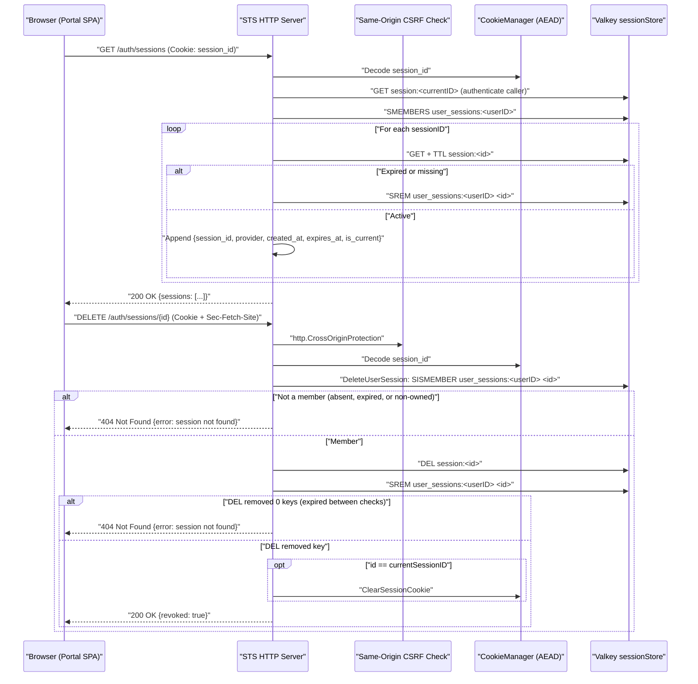

# Design

## Context

See [proposal.md](proposal.md) for product motivation and [specs/session-management/spec.md](specs/session-management/spec.md) for behavioral requirements.

Today, [internal/session/store.go](../../../../internal/session/store.go) stores each session at `session:<sessionID>` (with Valkey TTL) and tracks per-user session IDs in a Valkey Set `user_sessions:<userID>`. It supports `Get`, `Set`, `Delete`, `RevokeUserSessions`, and `ListAllExpiring`, but has no per-user session listing or selective revocation excluding the current session.

In [internal/http/server.go](../../../../internal/http/server.go), `GET /auth/sessions` returns `501 Not Implemented`, and `Server.Router()` duplicates route registration from `Server.StartWithMiddleware()`. In [internal/observability/metrics.go](../../../../internal/observability/metrics.go), `HTTPMetricsMiddleware` records raw `r.URL.Path`, which would cause unbounded Prometheus cardinality on parameterized `/auth/sessions/{session_id}` routes.

No PostgreSQL schema changes apply; all session state lives in Valkey.

## Goals / Non-Goals

**Goals:**

- Expose cookie-authenticated self-service endpoints: `GET /auth/sessions`, `DELETE /auth/sessions/{session_id}`, and `DELETE /auth/sessions` (with optional `?exclude_current=true`).
- Enforce strict session ownership via `Store.DeleteUserSession` and same-origin CSRF checks (`http.NewCrossOriginProtection`) across state-changing cookie routes (`POST /auth/logout`, `DELETE /auth/sessions`, `DELETE /auth/sessions/{session_id}`).
- Derive accurate `expires_at` values from Valkey's active TTL and lazily prune expired IDs from `user_sessions:<userID>`.
- Switch `HTTPMetricsMiddleware` to parameterized chi route patterns so UUID path segments never explode metric cardinality.

**Non-Goals:**

- Current-user profile inspection (`GET /auth/me`, handled in `add-whoami-endpoint`).
- Admin cross-user HTTP endpoints (cross-user revocation remains on gRPC `RevokeUserSessions`).
- Capturing client IP addresses or `User-Agent` headers in v1 session records.
- Cross-origin CORS configuration.

## Architecture

## Decisions

### 1. Cookie-Only Self-Service Authentication

All `/auth/sessions` endpoints authenticate using the caller's `session_id` cookie (`CookieManager.Decode` + `sessionStore.Get`), scoping every read and delete strictly to the caller's `UserID`.

- **Rationale**: Matches [ADR-004](../../../../docs/adr/004-phantom-token-pattern.md) (browser holds only opaque cookies), avoids a gateway JWT hairpin, and gives STS the exact calling `session_id` needed for `is_current` and `?exclude_current=true`.
- **Alternatives Considered**:
  - *Internal JWT authentication*: Current internal JWTs omit `session_id` and remain valid after revocation until `exp`, making `is_current` and live revocation checks unreliable.

### 2. Valkey Store Extensions with TTL-Derived Expiration and Lazy Pruning

Extend `session.Store` in [internal/session/store.go](../../../../internal/session/store.go) with:

- `DeleteUserSession(ctx context.Context, userID, sessionID string) error`: Verifies membership via `SISMEMBER user_sessions:<userID> <sessionID>`, deletes `session:<sessionID>`, and removes the ID via `SREM` without fetching or unmarshaling the target session payload.
- `ListUserSessions(ctx context.Context, userID string) ([]*Session, error)`: Reads `SMEMBERS user_sessions:<userID>`, fetches each `session:<id>` and its remaining `TTL`, sets each returned session's `ExpiresAt = now.Add(ttl)` when `ttl > 0`, and lazily `SREM`s missing or expired IDs from `user_sessions:<userID>`.
- `RevokeUserSessionsExcept(ctx context.Context, userID, keepSessionID string) (int, error)`: Deletes every session ID in `user_sessions:<userID>` except `keepSessionID` (using `DEL` + `SREM` over enumerated IDs, preserving any concurrent `SADD`; Valkey automatically deletes empty sets) and returns the number of revoked sessions.

- **Rationale**: Individual `session:<id>` keys expire automatically, but their IDs linger in `user_sessions:<userID>` because each new login refreshes the set's TTL. Deriving `expires_at` from Valkey `TTL` guarantees accuracy even after `sts extend-sessions --ttl ...` or mixed legacy sessions.
- **TTL Safety Note**: Update `ValkeyStore.Set` to avoid shrinking the `user_sessions:<userID>` set TTL below an existing longer TTL by pipelining `EXPIRE ... NX` and `EXPIRE ... GT` in a single `DoMulti` call.
- **Alternatives Considered**:
  - *Redis Sorted Set (`ZSET`) indexed by expiry timestamp*: Adds migration complexity for existing `user_sessions:<userID>` Sets with minimal gain since typical users hold single-digit open sessions.
  - *Trust `Session.ExpiresAt` alone*: Can drift from actual Valkey TTL for legacy OIDC sessions or custom `--ttl` extensions.

### 3. Strict Ownership Verification Returning `404 Not Found`

On `DELETE /auth/sessions/{session_id}`, the handler calls `Store.DeleteUserSession(ctx, caller.UserID, targetID)`. The store checks ownership with `SISMEMBER user_sessions:<userID> <targetID>`; if the ID is not a member, it returns `session.ErrSessionNotFound` without touching `session:<targetID>`. Otherwise it runs `DEL session:<targetID>` and then `SREM user_sessions:<userID> <targetID>`. The target session payload is never fetched or unmarshaled. If `DEL` removed no key (the session expired between the membership check and the delete), the store also returns `ErrSessionNotFound`. The handler maps `ErrSessionNotFound` to `404 Not Found`, so an absent, expired, or non-owned session produce identical responses. Other store errors return `503 Service Unavailable`.

- **Rationale**: Eliminates cross-user IDOR and prevents an authenticated user from probing whether arbitrary session UUIDs exist (`403` vs `404` oracle). Ownership is decided by the per-user index alone, so no cross-user payload is read.
- **Alternatives Considered**:
  - *Return `403 Forbidden` on foreign session IDs*: Leaks existence of valid session UUIDs belonging to other users.
  - *Fetch the target `session:<targetID>`, compare `target.UserID` with `caller.UserID`, then delete*: Reads another user's payload before rejecting it and adds a round trip; the membership check makes it unnecessary.

### 4. Stdlib `http.NewCrossOriginProtection` on State-Changing Cookie Routes

Guard `POST /auth/logout`, `DELETE /auth/sessions`, and `DELETE /auth/sessions/{session_id}` using Go stdlib `http.NewCrossOriginProtection()` with a JSON `403 Forbidden` deny handler. It allows `Sec-Fetch-Site: same-origin` and `none`, falls back to full `Origin` scheme+host matching against `Host` when `Sec-Fetch-Site` is absent, and allows non-browser callers omitting both headers.

- **Rationale**: Adds defense-in-depth on top of `SameSite=Lax` without requiring stateful CSRF token storage or breaking CLI/test automation.
- **Alternatives Considered**:
  - *Double-submit CSRF cookie*: Extra client complexity for a same-origin API where `DELETE` already cannot be triggered by simple HTML forms.
  - *Reject requests missing both headers*: Breaks standard `curl -b cookies.txt -X DELETE` operational workflows.

### 5. Parameterized Route Labels in `HTTPMetricsMiddleware`

Update `HTTPMetricsMiddleware` in [internal/observability/metrics.go](../../../../internal/observability/metrics.go) to resolve `chi.RouteContext(r.Context()).RoutePattern()` after `next.ServeHTTP` (falling back to `r.URL.Path` only when no chi route matched, or `"unmatched"` for 404s).

- **Rationale**: Prevents every unique `session_id` UUID in `DELETE /auth/sessions/{session_id}` from creating a permanent Prometheus time series.
- **Alternatives Considered**:
  - *Pass `session_id` in JSON body on `POST /auth/sessions/revoke`*: Avoids path parameters but sacrifices clean REST semantics and leaves `HTTPMetricsMiddleware` fragile for future parameterized routes.

## Security, Performance, Observability, and Scalability

- **Security**: Every endpoint sets `Cache-Control: no-store`, `Vary: Cookie`, and `X-Content-Type-Options: nosniff`. Upstream OAuth2 tokens and raw claims are never included in session-list JSON. AEAD cookie verification rejects forged cookies before touching Valkey.
- **Performance & Scalability**: A user typically has 1–20 open sessions; `ListUserSessions` performs bounded Valkey lookups proportional to that user's active sessions and cleans up expired entries lazily. No full-keyspace `SCAN` occurs.
- **Observability**: Structured audit logs record session revocation events (`user_id`, revoked `session_id` or `revoked_count`, `exclude_current`, outcome) without logging raw cookie values or tokens. Parameterized `http.route` labels keep metric cardinality bounded.

## Risks / Trade-offs

- **[User holds an unusually large number of stale IDs in `user_sessions:<userID>`]** -> Mitigate by lazily `SREM`ing expired IDs on `ListUserSessions` and pipelining Valkey `GET`/`TTL` calls if needed.
- **[Race between concurrent `DELETE /auth/sessions/{id}` and TTL expiry]** -> Mitigate by treating `ErrSessionNotFound` during delete as `404 Not Found` and making `SREM` idempotent.
- **[Already-minted internal JWTs remain valid after session revocation]** -> Accepted trade-off per [ADR-004](../../../../docs/adr/004-phantom-token-pattern.md); short `JWT_EXPIRY` bounds the window, and no new JWTs can be minted once the session is deleted.
- **[Legacy callers expecting `501` on `GET /auth/sessions`]** -> Unlikely since the stub returned a placeholder body; documented clearly in OpenAPI and release notes.

## Migration Plan

1. Deploy the updated STS binary; no PostgreSQL migration or Valkey key-format migration is required.
2. Existing `user_sessions:<userID>` Sets and `session:<id>` keys work immediately; stale set members prune automatically on first `GET /auth/sessions`.
3. Update [docs/api/openapi.yaml](../../../../docs/api/openapi.yaml) with the new `/auth/sessions` and `/auth/sessions/{session_id}` contracts.
4. Roll back by redeploying the previous binary; no persistent schema changes were introduced.
